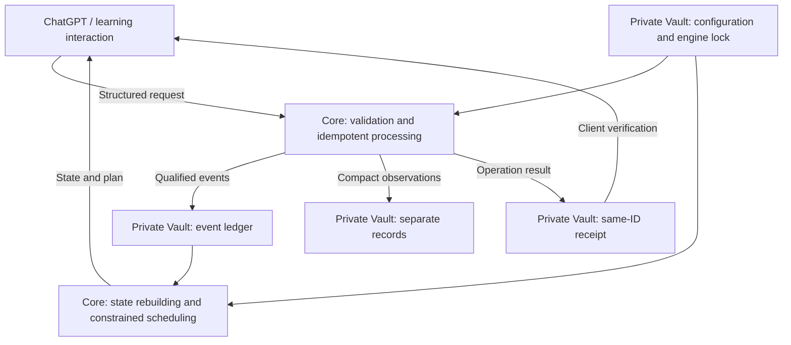

# Postgrad Study Engine

**v0.5.0 experimental learning loop:** initialize a blank private Vault, run an
authored nine-unit / 14-day fictional learning loop, fit a recall model, evaluate
chronological predictions, inspect prerequisite probes and open a local HTML
report. Optional FSRS and an explicit OpenAI teaching adapter are included;
each learner's evidence and parameters remain separate. The reproducible
[synthetic sanity report](docs/CALIBRATION_REPORT_0_5_0.md) does not establish
human calibration.

```sh
python -m scripts.study demo --vault ../fictional-study-demo
python -m scripts.study today --vault ../fictional-study-demo --as-of 2026-08-15T09:00:00Z
```

Run from the clean v0.5.0 checkout and open the demo's `reports/demo.html`.
See [the learning-loop guide](docs/LEARNING_MODELS.md) and the repository-maintained
[teaching Skill](skills/study-tutor/SKILL.md). Model fitting and passing software
tests do not establish calibrated predictions or improved learning outcomes.

[简体中文](README.md) · [English](README.en.md)

**An Open, Evidence-Based Learning Engine**

Help AI move from answering questions to supporting long-term, verifiable learning.

[](https://github.com/wysking/postgrad-study-engine/releases)
[](https://github.com/wysking/postgrad-study-engine/actions/workflows/test.yml)
[](.github/workflows/test.yml)
[](LICENSE)
[](LICENSE-DOCS-CC-BY-4.0)

ChatGPT can explain a problem, but understanding an explanation, succeeding with hints, and solving independently provide different kinds of evidence. One correct answer does not establish long-term retention. Learners need a system that preserves what actually happened, tracks errors and the reasons for review, and leaves unsupported conclusions unknown.

Postgrad Study Engine provides open, auditable, reusable infrastructure for that purpose. An interaction layer handles teaching; the Python Core validates requests and applies deterministic rules; a separate private Vault holds learning evidence and configuration. Postgraduate entrance exam preparation is the starting point. The long-term goal is to keep verified learning evidence understandable, portable, and reviewable as models, devices, and interaction tools change.

The Core validates structured evidence, maintains an append-only event ledger, rebuilds derived state, and schedules work under explicit constraints. It distinguishes independent performance from assisted success and can store incomplete observations without inventing assessments. ChatGPT is an interaction layer; this repository does not host a chatbot or an OpenAI API service.

[What we've built](#what-weve-built) · [Development status](#development-status) · [How it works](#how-it-works) · [Quick start](#quick-start) · [Roadmap](#roadmap) · [Contributing](#community--contributing)

## Vision & Mission

Give the next step in AI-assisted learning an evidence base beyond impressions from a single conversation.

- **Record learning facts.** Preserve actual responses, assistance, errors, and corrections. Missing timing, confidence, and outcomes remain unknown.
- **Distinguish evidence strength.** Understanding, recall, independent solving, transfer, speed, and long-term retention each need their own evidence.
- **Make state auditable.** Rebuild summaries from retained events and expose the basis for review and task selection.
- **Separate data from interaction tools.** Share the reusable engine while keeping each learner's profile and history in a private Vault.

These are design goals. Software validation does not establish learning effectiveness or improved exam scores.

## What We've Built

| Capability | Value to learners and integrators | Evidence |
| --- | --- | --- |
| Structured learning evidence and versioned contracts | Record responses and diagnoses explicitly rather than treating every conversation as a capability gain | [Data contracts](docs/DATA_CONTRACTS.md), [schemas](schemas/README.md) |
| Separate independent and assisted performance | Assisted or unverified success cannot qualify as independent solving evidence | [v0.3.1 review](docs/RELEASE_REVIEW_0_3_1.md), [evidence tests](tests/test_evidence_qualification.py) |
| Error diagnosis and targeted review | Start from observable deviations; distinguish hypotheses, confirmation, and delayed checks | [Error-closure protocol](docs/ERROR_CLOSURE_PROTOCOL.md) |
| Append-only events and deterministic state rebuilding | Trace history and recompute derived summaries from the ledger | [Data contracts](docs/DATA_CONTRACTS.md), [reducer](scripts/reducer.py) |
| Constrained scheduling across subjects | Select tasks under time budgets, phases, prerequisites, and due dates, with reasons for tradeoffs | [Scheduler documentation](docs/GLOBAL_SCHEDULER.md) |
| Structured mobile requests and matching receipts | Confirm an operation from its own result and handle repeated requests idempotently | [Requests and receipts](docs/MOBILE_REQUESTS.md) |
| Public Core and private Vault separation | Reuse the engine without publishing personal history or adopting another learner's plan | [Integration workflow](docs/MOBILE_DESKTOP_WORKFLOW.md) |
| Compact study observations, v0.4.0 | Preserve real observations without requiring a complete assessment or inventing capability judgments | [Compact record contract](docs/LIGHTWEIGHT_STUDY_RECORDS.md) |

For example, v0.4.0 can preserve an observation that a learner worked on a problem but did not record the result or assistance. This does not increase formal attempt counts, update mastery, schedule review, or automatically queue an assessment.

## Development Status

**Current public release: [v0.5.0](https://github.com/wysking/postgrad-study-engine/releases/tag/v0.5.0).** The core infrastructure is established, with reliability and usability still being improved. Current deliverables are contracts, Python tools, protocols, and integration workflows.

| Release | Milestone | Release evidence |
| --- | --- | --- |
| v0.3.0 | Public Core, data contracts, mobile request processing, state rebuilding, and study scheduling | [Release](https://github.com/wysking/postgrad-study-engine/releases/tag/v0.3.0) |
| v0.3.1 | Stronger independent-evidence qualification, diagnosis closure, scheduling gates, consistency, and recovery | [Release](https://github.com/wysking/postgrad-study-engine/releases/tag/v0.3.1), [review](docs/RELEASE_REVIEW_0_3_1.md) |
| v0.4.0 | Separately stored compact observations while preserving formal event contracts | [Release](https://github.com/wysking/postgrad-study-engine/releases/tag/v0.4.0), [release notes](docs/RELEASE_NOTES_0_4_0.md) |
| v0.5.0 | Unified study CLI, learner-specific recall fitting, optional FSRS, prerequisite probes, teaching adapters and synthetic calibration checks | [Release](https://github.com/wysking/postgrad-study-engine/releases/tag/v0.5.0), [release and review](docs/RELEASE_NOTES_0_5_0.md) |

The v0.4.0 release verification records **136 unit and integration tests using fictional data**, including 18 compact-record boundary and recovery checks, with Linux and Windows CI verification. These counts describe that release; see the [v0.5.0 review](docs/RELEASE_REVIEW_0_5_0.md) and CI badge for current verification. Tests verify software behavior, not long-term learning effects.

A public release and its adoption by a private Vault are separate steps. Each Vault pins an exact commit in `engine.lock.json`; upgrades require separate review. Publishing a release does not automatically change a learner's runtime. See the [changelog](CHANGELOG.md).

## How It Works



Interaction tools such as ChatGPT explain, ask questions, observe responses, and propose possible error causes. The Core applies deterministic rules when invoked by a client or workflow. The private Vault supplies personal profiles, subject settings, evidence, and the selected runtime version. The arrows describe structured integration; they do not represent a hosted ChatGPT service or automatic API calls supplied by this repository.

Compact observations remain separate from capability state and scheduling. A client confirms a result by checking the same-ID receipt's operation, request hash, and expected event or record. `succeeded` confirms the corresponding operation; `pending` for a `project_change_request` means it was registered for review; `failed` does not confirm archiving. See [mobile requests](docs/MOBILE_REQUESTS.md).

## Quick Start

You need Git and Python; CI uses **Python 3.12**. The runtime uses only the Python standard library.

### 1. Get and verify a published version

```sh
git clone --branch v0.5.0 https://github.com/wysking/postgrad-study-engine.git
cd postgrad-study-engine
python -m unittest discover -s tests -v
python -m scripts.validate_events
```

The default demonstration ledger is empty. Validating it checks the installation and contract entry point; it does not mean learning data has been imported.

### 2. Run a fictional example

Run these commands from the repository root in Git Bash, a typical Unix shell, or PowerShell. Outputs go only to the ignored `state/local/readme-demo/` directory. Use an empty demo directory for the first run: the example has a fixed identity, and appending the same event again is rejected.

```sh
python -m scripts.append_event --event examples/attempt_clean_correct.json --events state/local/readme-demo/events.jsonl
python -m scripts.validate_events --events state/local/readme-demo/events.jsonl
python -m scripts.rebuild_state --events state/local/readme-demo/events.jsonl --units state/knowledge_units.json --output state/local/readme-demo/derived_state.json
python -m scripts.schedule_global --state state/local/readme-demo/derived_state.json --request examples/schedule_request.json --config config/scheduler.json --output state/local/readme-demo/schedule.json
```

Expected result: append and validate one fictional event, rebuild state containing one knowledge unit, and generate a demonstration plan. Inspect `derived_state.json` and `schedule.json` for evidence summaries, selected tasks, time budgets, and exclusion reasons. One independent success is still insufficient for an overall mastery conclusion.

The example's timestamps, candidates, and performance are fictional. Do not copy them into real learning history or treat the plan as a current recommendation. Alternatively, `python -m unittest tests.test_cli_workflow -v` checks the CLI flow in an automatically cleaned temporary directory.

### 3. Connect your own private Vault

Start with the [step-by-step guide](docs/GETTING_STARTED.md): prepare an empty Vault, pin the runtime commit, review configuration, and verify the request/receipt loop with a schedule request that adds no learning events.

Read the [integration workflow](docs/MOBILE_DESKTOP_WORKFLOW.md), [request contract](docs/MOBILE_REQUESTS.md), and [migration notes](migrations/README.md) before configuring private data and the exact engine lock. Replace the adjacent path below with your configured Vault:

```sh
python -m scripts.process_inbox --vault-root ../private-vault
```

This is an integrator entry point. There is no one-click installer that creates and hosts a personal learning system. Compact records also require compatible Vault persistence and a supporting locked runtime; see [adoption and rollback](docs/LIGHTWEIGHT_STUDY_RECORDS.md#adoption-rollback-and-later-assessment).

## Roadmap

The following separates current capabilities, research directions, and long-term product ideas. It promises neither delivery dates nor learning outcomes.

| Stage | Status | Direction and verification |
| --- | --- | --- |
| 1. Trustworthy learning records | Core capabilities implemented; ongoing improvements | Preserve real evidence, independent performance, diagnoses, and review grounds; verify behavior through v0.3.x–v0.4.0 contracts, replay, and boundary tests |
| 2. Individual modeling and study planning | Experimental models implemented in v0.5.0; human calibration pending | Per-learner half-life fitting, temporal evaluation, optional FSRS and prerequisite probes; validate transfer, changing retention and real scheduling effects next |
| 3. Reusable AI learning infrastructure | CLI, teaching Skill and OpenAI adapter implemented; ongoing development | Expand authored real courses and deployment/access; hosted multi-user operation and long-term effects need separate implementation and validation |

The [memory and scheduling roadmap](docs/MEMORY_AND_SCHEDULING_MODEL_ROADMAP.md) describes stage 2 directions and adoption gates: preserve historical events, compare against the deterministic baseline, and provide replay tests, reproducible outputs, and rollback. Uncalibrated scores must not be presented as mastery probabilities or guaranteed score improvements.

Stage 3 is exploratory and does not change the current Core scope. New services, interfaces, and models require separate proposals and review. The [reasoning-evidence design in PR #3](https://github.com/wysking/postgrad-study-engine/pull/3) is also a separate draft, not an active contract or deployed capability.

## Principles & Limitations

- **Evidence before judgment.** Never attribute AI-completed steps to the learner. Separate later clarification from the original response and label system inferences. Authenticity still depends on faithful observation and client verification.
- **Unknown stays unknown.** Assisted success, independent success, transfer, measured speed, and delayed retention cannot substitute for one another. Recent success does not establish stable mastery.
- **Append-only history.** State is rebuildable; model upgrades do not rewrite historical events. Incompatible contracts require versioned migrations and compatibility checks.
- **Private data stays in the Vault.** The public repository contains reusable contracts, tools, blank configuration, and fictional examples, not real learning history, full conversations, raw images, or textbook content.
- **Determinism has limits.** Current multi-file publication handles caught errors but lacks database-style crash atomicity. Independent workflow runners still need serialized processing. See [request recovery and receipts](docs/MOBILE_REQUESTS.md).
- **Learning effects need validation.** Scheduling currently uses transparent heuristics, not a calibrated learning model or a mathematically global optimum. Improved exam scores or long-term learning outcomes have not been demonstrated. This project has no official OpenAI certification or endorsement.

## Community & Contributing

Contributions can start with clearer documentation, reproducible bug reports, fictional boundary cases, and tests. Use [Issues](https://github.com/wysking/postgrad-study-engine/issues) for problems or suggestions and [Pull Requests](https://github.com/wysking/postgrad-study-engine/pulls) for review and contributions.

Include the runtime version, expected and actual behavior, and a minimal **fictional** reproduction. Do not upload a private Vault, real receipts, personal responses, or paid third-party materials.

Read [AGENTS.md](AGENTS.md) and the [change protocol](docs/PROJECT_ITERATION_HANDOFF.md) before editing. Code, schema, and learning-protocol changes follow the existing change-request and PR review process. Private Vault version adoption is reviewed separately. Run the tests and ledger validation above before submitting changes.

### Technical Documentation

| Topic | Entry points |
| --- | --- |
| First-time setup | [Step-by-step guide](docs/GETTING_STARTED.md) |
| Data and tools | [Data contracts](docs/DATA_CONTRACTS.md), [schemas](schemas/README.md), [scripts](scripts/README.md) |
| Teaching and errors | [Study session protocol](docs/STUDY_SESSION_PROTOCOL.md), [error closure](docs/ERROR_CLOSURE_PROTOCOL.md) |
| Mobile integration and records | [Workflow](docs/MOBILE_DESKTOP_WORKFLOW.md), [requests and receipts](docs/MOBILE_REQUESTS.md), [compact records](docs/LIGHTWEIGHT_STUDY_RECORDS.md) |
| Scheduling and future models | [Global scheduler](docs/GLOBAL_SCHEDULER.md), [model roadmap](docs/MEMORY_AND_SCHEDULING_MODEL_ROADMAP.md) |
| Releases and maintenance | [Changelog](CHANGELOG.md), [v0.3.1 review](docs/RELEASE_REVIEW_0_3_1.md), [v0.4.0 notes](docs/RELEASE_NOTES_0_4_0.md), [migrations](migrations/README.md) |

## Licensing

- Python code is licensed under **MIT**; see [LICENSE](LICENSE).
- Documentation, protocols, schemas, and templates are licensed under **CC BY 4.0**; see [LICENSE-DOCS-CC-BY-4.0](LICENSE-DOCS-CC-BY-4.0).
- Third-party textbooks, paid courses, scans, question banks, and other source works are not included or relicensed by references in this repository. See [NOTICE](NOTICE.md).
