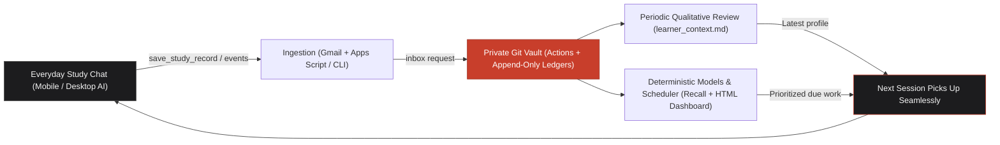

<div align="center">


<br />
<br />

# Postgrad Study Engine

**Turn every question and derivation into structured memory for your next study session.**

<sub>Open-source, Git-backed AI study engine for postgraduate exams & long-term self-study · Open Records · Periodic Profiles · Recall Modeling · Constrained Scheduling</sub>

<br />

[](https://github.com/wysking/postgrad-study-engine/releases)
[](https://github.com/wysking/postgrad-study-engine/actions/workflows/test.yml)
[](scripts/study.py)
[](LICENSE)
[](LICENSE-DOCS-CC-BY-4.0)

<br />

[简体中文](README.md) · **English**
&nbsp;&nbsp;|&nbsp;&nbsp;
[Highlights](#highlights) · [How It Works](#architecture) · [Memory Architecture](#memory) · [Quick Start](#quickstart) · [Ways to Run](#modes) · [Docs](#docs)

</div>

---

## ✨ Why Postgrad Study Engine?

The biggest loss in AI-assisted self-study isn't missing an explanation—it's **forgetting everything the moment you open a new chat window**.

<table>
  <thead>
    <tr>
      <th width="22%">Dimension</th>
      <th width="39%">Ordinary AI Chat Practice</th>
      <th width="39%">Postgrad Study Engine</th>
    </tr>
  </thead>
  <tbody>
    <tr>
      <td><b>Long-Term Memory</b></td>
      <td>Scattered across dozens of threads; every new chat starts from scratch</td>
      <td>Accumulates in your private Git ledger and loads a fresh learner profile at session start</td>
    </tr>
    <tr>
      <td><b>Logging Friction</b></td>
      <td>Manual note-taking breaks flow, or insights vanish completely</td>
      <td>Captures real problem-solving naturally—brief for easy wins, rich for multi-step derivations</td>
    </tr>
    <tr>
      <td><b>Mastery Signal</b></td>
      <td>Reading a solution, assisted fixes, and solo solves blur together</td>
      <td>Strictly separates independent solving, assisted work, and confirmed error diagnoses</td>
    </tr>
    <tr>
      <td><b>Portability</b></td>
      <td>History locked inside one vendor's chat interface</td>
      <td>Public Core + private Git Vault in plain JSON/Markdown—portable across devices & models</td>
    </tr>
  </tbody>
</table>

---

<a id="highlights"></a>
## 🧩 Highlights

<table>
  <tr>
    <td width="50%" valign="top">
      <h3>01 · Frictionless Capture, Rich Detail</h3>
      <p>Everyday logging defaults to open study records (<code>save_study_record</code>) with zero form fatigue. Keep direct answers concise, and retain initial attempts, hint sequences, local mistakes, and self-corrections whenever they occur.</p>
    </td>
    <td width="50%" valign="top">
      <h3>02 · Clean Core / Vault Separation</h3>
      <p>This public Core provides reusable contracts, validation, state rebuilding, and scheduling. Your personal profile, raw ledgers, and derived insights stay in your own private Vault—switching devices or AI clients never resets your progress.</p>
    </td>
  </tr>
  <tr>
    <td width="50%" valign="top">
      <h3>03 · Serverless Cloud Loop</h3>
      <p>Run locally with the CLI or pair a private GitHub Vault with GitHub Actions and a native cloud bridge (Google Drive read-only mirrors + Gmail Drafts + scheduled Apps Script sync) for mobile tutoring, automatic archival, and overnight reviews—no hosted server or paid LLM API required.</p>
    </td>
    <td width="50%" valign="top">
      <h3>04 · Auditable & Rebuildable Core</h3>
      <p>Append-only ledgers, idempotent request deduplication, exact same-ID outbox receipts, and serialized publishing—paired with deterministic state rebuilds, constrained multi-subject scheduling, optional recall fitting, and FSRS support.</p>
    </td>
  </tr>
</table>

---

<a id="architecture"></a>
## 🔄 How It Works



---

<a id="memory"></a>
## 🗂️ Three-Layer Memory Architecture

Logging and analysis stay cleanly decoupled—**saving facts never waits on downstream analysis**, keeping everyday study fast while deeper reviews run on their own schedule:

| Layer | Files | What It Preserves or Produces | Cadence |
| :--- | :--- | :--- | :--- |
| **L1 · Open Study Records** | `records/study_records.jsonl` | Problem context, real steps, hint order, mistakes, corrections, and observed timing | Saved effortlessly during study |
| **L2 · Qualitative Learner Profile** | `analysis/learner_context.md`<br>`analysis/daily/YYYY-MM-DD.md` | Cross-session progress, recurring pitfalls, effective explanation styles, and source citations | Daily or weekly review; loaded at session start |
| **L3 · Formal Evidence & Models** | `events/learning_events.jsonl`<br>`state/` · `exports/` | Structured attempts and diagnoses distinguishing solo vs. assisted work, recall risk, and schedules | Targeted diagnostics, transfer checks, and planning |

<details>
<summary><b>👀 Peek at a real open study record payload (clean, human-readable, zero boilerplate)</b></summary>

```json
{
  "schema_version": "1.0",
  "request_id": "mobile-20261121-math-chain-rule-001",
  "created_at": "2026-11-21T20:15:00+08:00",
  "operation": "save_study_record",
  "client": "mobile",
  "payload": {
    "summary": "Practised composite-function differentiation. Omitted the inner derivative on the first pass; after a chain-rule hint, completed the full derivation accurately and restated the outer-to-inner expansion order.",
    "subject_label": "math",
    "topic": "Composite derivatives & chain rule",
    "occurred_on": "2026-11-21"
  }
}
```

</details>

---

<a id="quickstart"></a>
## ⚡ Quick Start

Requires only **Git** and **Python 3.12** (zero third-party runtime dependencies—pure standard library):

```sh
git clone --branch v0.5.1 https://github.com/wysking/postgrad-study-engine.git
cd postgrad-study-engine
python -m scripts.study demo --vault ../study-demo
```

> [!TIP]
> Open `../study-demo/reports/demo.html` to explore a 14-day sample study dashboard featuring independent solves, assisted fixes, error diagnosis closure, rebuilt unit evidence, and prioritized review queues.

---

<a id="modes"></a>
## 🚀 Ways to Run

Initialize a blank private Vault with the [first-time setup guide](docs/GETTING_STARTED.md), then pick or combine the modes that fit your workflow:

<table>
  <tr>
    <td width="33%" valign="top">
      <h4>💻 Local CLI</h4>
      <p>Zero-dependency Python runtime. Use <code>python -m scripts.study</code> to save records, rebuild state, inspect due work, and export standalone HTML dashboards.</p>
      <p><a href="docs/GETTING_STARTED.md">Local setup guide →</a></p>
    </td>
    <td width="33%" valign="top">
      <h4>📱 Mobile Cloud Loop (Recommended)</h4>
      <p>Pair your private Vault with GitHub Actions single-writer workflows and a <b>Google Drive mirror + Gmail Draft + Apps Script</b> 5-minute bridge for seamless mobile tutoring and overnight reviews.</p>
      <p><a href="docs/EVERYDAY_LEARNING.md#english-setup-guide">Cloud setup guide →</a></p>
    </td>
    <td width="33%" valign="top">
      <h4>🔧 Custom Integrations</h4>
      <p>9 structured <code>inbox</code> operations with full JSON Schemas—connect any AI client, define custom subject prerequisites, or plug in authored diagnostic probes.</p>
      <p><a href="docs/MOBILE_REQUESTS.md">Request contracts →</a></p>
    </td>
  </tr>
</table>

---

## 📦 Capabilities (v0.5.1)

| Area | What Is Included |
| :--- | :--- |
| **Open Study Records** | Lightweight `save_study_record` persistence with free-form summary, subject label, topic, source reference, and date |
| **Evidence & Diagnosis Loop** | Separates solo solves, assisted fixes, guesses, and diagnosis revisions with isomorphic & transfer verification |
| **Cross-Device Request Protocol** | 9 structured `inbox` operations with idempotent deduplication, single-writer concurrency, and exact `outbox` receipts |
| **State, Models & Scheduling** | Deterministic state rebuilding, multi-subject constrained priority scheduling, optional recall fitting, and FSRS support |
| **Reporting & Test Suite** | Unified CLI, compact context capsules, standalone HTML dashboard, and comprehensive unit test coverage |

---

<a id="docs"></a>
## 📚 Documentation

| Topic | Recommended Reading |
| :--- | :--- |
| **Getting Started & Daily Loop** | [First-Time Setup](docs/GETTING_STARTED.md) · [Everyday Learning & Review](docs/EVERYDAY_LEARNING.md#english-setup-guide) |
| **Cloud Sync & Request Contracts** | [Cross-Device Workflow](docs/MOBILE_DESKTOP_WORKFLOW.md) · [Mobile Requests](docs/MOBILE_REQUESTS.md) · [Open Records Contract](docs/LIGHTWEIGHT_STUDY_RECORDS.md) |
| **Data Models & Scheduler** | [Data Contracts](docs/DATA_CONTRACTS.md) · [Schemas](schemas/README.md) · [Learning Models](docs/LEARNING_MODELS.md) · [Global Scheduler](docs/GLOBAL_SCHEDULER.md) |
| **Releases & Contributing** | [Changelog](CHANGELOG.md) · [Model Roadmap](docs/MEMORY_AND_SCHEDULING_MODEL_ROADMAP.md) · [Repository Rules](AGENTS.md) |

---

<div align="center">

Feedback, [Issues](https://github.com/wysking/postgrad-study-engine/issues), and [Pull Requests](https://github.com/wysking/postgrad-study-engine/pulls) are always welcome.

Code licensed under [MIT](LICENSE) · Documentation, protocols & schemas under [CC BY 4.0](LICENSE-DOCS-CC-BY-4.0) · Attributions in [NOTICE.md](NOTICE.md)

</div>
