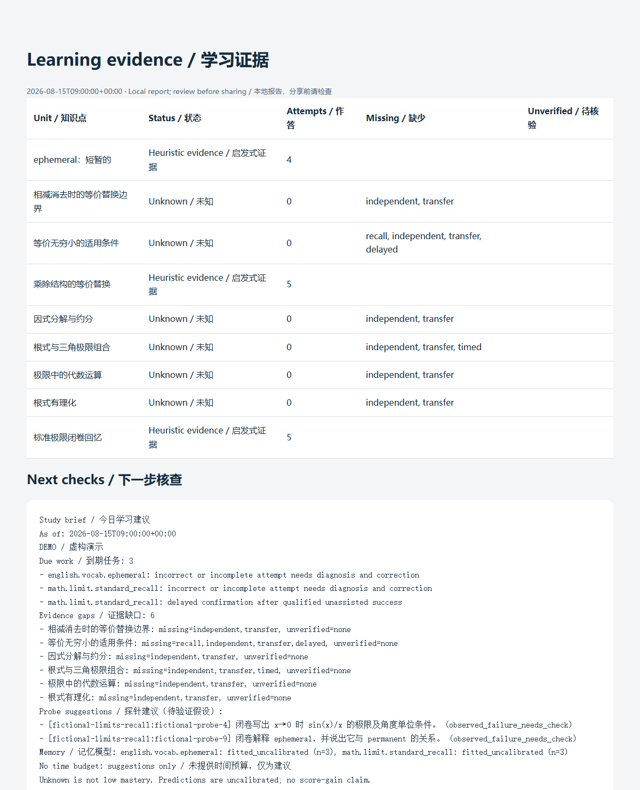

<div align="center">


# Postgrad Study Engine

### Long-term memory engine for AI tutors

<sub>Open-source <b>Long-term Memory</b> &amp; <b>Spaced Repetition</b> (Half-Life / <b>FSRS</b>) engine for <b>AI Tutors</b> — a derivation-friendly <b>Anki Alternative</b> built for <b>Kaoyan</b> and deep self-study</sub>

<br />

[](https://colab.research.google.com/github/wysking/postgrad-study-engine/blob/main/demo.ipynb)
[](https://github.com/wysking/postgrad-study-engine/releases)
[](https://github.com/wysking/postgrad-study-engine/actions/workflows/test.yml)
[](scripts/study.py)
[](LICENSE)

<br />

[简体中文](README.md) · **English**
&nbsp;&nbsp;|&nbsp;&nbsp;
[Run in Colab](https://colab.research.google.com/github/wysking/postgrad-study-engine/blob/main/demo.ipynb) · [Dual AI Setup (Gemini / ChatGPT)](docs/AI_INTEGRATIONS.md#english-dual-ai-integration-guide) · [Architecture](docs/ARCHITECTURE_OVERVIEW.md#english-technical-overview) · [Contributing](CONTRIBUTING.md)

</div>

---

> **AI chat tutors forget your weak spots the moment you open a new thread, while traditional flashcards (Anki) flatten multi-step derivations into rote front/back cards.**  
> Postgrad Study Engine archives every real problem-solving exchange, hint, and mistake in a private Git ledger—powering **FSRS / half-life forgetting curves** and periodic learner profiles so your AI tutor remembers what you actually know.

<div align="center">



<sub>▲ Real zero-JS local dashboard generated by running the built-in <code>fictional-14-days</code> example (<code>reports/demo.html</code>)</sub>

</div>

## ⚡ Quick Start in 3 Lines (or click [Open in Colab](https://colab.research.google.com/github/wysking/postgrad-study-engine/blob/main/demo.ipynb) for zero-install run)

```sh
git clone https://github.com/wysking/postgrad-study-engine.git
cd postgrad-study-engine
python -m scripts.study demo --vault ../study-demo
```

Open `../study-demo/reports/demo.html` to explore the full dashboard shown above (Python 3.12 standard library only—zero third-party dependencies, no API key required).

> ⭐ **If you want your AI tutor to remember your derivation bottlenecks and forgetting curves across sessions, consider giving this repo a Star!**

---

## 💬 Day 1 → Day 14: What Changes When Your AI Tutor Has Memory?

<table>
  <thead>
    <tr>
      <th width="50%">❌ Ordinary AI Chat (Day 14 New Thread)</th>
      <th width="50%">✅ With Postgrad Study Engine (Profile + Recall Curve Loaded)</th>
    </tr>
  </thead>
  <tbody>
    <tr>
      <td valign="top">
        <p><b>You</b>: Give me two calculus limit review problems.</p>
        <p><b>AI</b>: Sure! Try these standard exercises: 1. <code>lim(x→0) (e^x - 1)/x</code>; 2. <code>lim(x→∞) (1 + 1/x)^x</code>…</p>
        <p><sub>⚠️ Has no idea you missed the radian condition on <code>sin(x)/x</code> 4 days ago or already mastered standard multiplicative equivalences.</sub></p>
      </td>
      <td valign="top">
        <p><b>You</b>: Give me two calculus limit review problems.</p>
        <p><b>AI</b>: Your fitted half-life on <i>Standard Limit Recall</i> is <b>2.7 days</b> (projected retention dropped below 30% today), and you needed a hint on the angle-unit condition 4 days ago. Start with this 3-min closed-book probe: <i>state lim(x→0) sin(x)/x and its angle-unit condition</i> before moving to additive cancellation boundaries.</p>
        <p><sub>✨ Picks up right at your real bottleneck and keeps solo solves distinct from assisted fixes.</sub></p>
      </td>
    </tr>
  </tbody>
</table>

---

## 🔌 Two Ready-to-Deploy AI Integrations (Gemini & ChatGPT / Codex)

Both tracks write to the exact same private Git Vault (`Schema 1.0`), so you can switch models or mix devices without losing a single day of memory:

<table>
  <tr>
    <td width="50%" valign="top">
      <h3>🌐 Track A: Gemini Google-Native Bridge (Zero Remote MCP)</h3>
      <p><b>Google Drive Mirrors + Gmail Drafts + Apps Script V8 → GitHub Actions</b></p>
      <ul>
        <li>Works with native Gemini chat &amp; 02:00 scheduled reviews — <b>zero paid LLM API</b></li>
        <li>No fragile third-party remote GitHub MCP, no GCP billing, no public <code>doPost</code> Web App</li>
        <li>Includes Drive API v3 fast in-place updates (2–3s), single-repo PAT, local schema checks &amp; 11 Node.js tests</li>
      </ul>
      <p>👉 <a href="integrations/google-native-bridge/"><b>Copy the full bridge code &amp; prompts →</b></a></p>
    </td>
    <td width="50%" valign="top">
      <h3>🤖 Track B: ChatGPT / OpenAI / Codex Integration</h3>
      <p><b>ChatGPT (GitHub Connector / Scheduled) · Codex CLI → GitHub Actions</b></p>
      <ul>
        <li>Load the built-in <code>skills/study-tutor/SKILL.md</code> to write structured <code>inbox/&lt;request_id&gt;.json</code> requests and verify exact <code>outbox</code> receipts</li>
        <li>Schedule periodic qualitative reviews that refresh <code>analysis/learner_context.md</code> across multi-turn derivations</li>
        <li>Also runs completely offline via local Python CLI (<code>python -m scripts.study</code>)</li>
      </ul>
      <p>👉 <a href="docs/AI_INTEGRATIONS.md#english-dual-ai-integration-guide"><b>Compare both integration tracks →</b></a></p>
    </td>
  </tr>
</table>

---

## 🧩 Why It Beats Chat History & Traditional Flashcards

| Dimension | Ordinary AI Chat Threads | Traditional Flashcards (Anki) | Postgrad Study Engine |
| :--- | :--- | :--- | :--- |
| **Long-term Memory** | Lost across scattered threads | Isolated cards with no derivation history | Append-only Git ledger + auto-updated `learner_context.md` |
| **Capture Friction** | Manual notes break study flow | High card-creation overhead for proofs | Frictionless `save_study_record` preserving hint sequences & fixes |
| **Spaced Repetition** | None—review only what you remember | Self-graded buttons ignore hints vs. solo work | Separates **solo solves** from **assisted fixes** with half-life / **FSRS** |
| **Data Ownership** | Locked inside one vendor's chat UI | Siloed local deck database | **Public Core + Private Git Vault** in plain JSON/Markdown |

---

## 📚 Documentation

| Topic | Links |
| :--- | :--- |
| **Dual AI Setup (Gemini / ChatGPT)** | [Dual AI Integration Guide](docs/AI_INTEGRATIONS.md#english-dual-ai-integration-guide) · [Google-Native Bridge Package](integrations/google-native-bridge/) |
| **Architecture & Getting Started** | [Architecture & FAQ](docs/ARCHITECTURE_OVERVIEW.md#english-technical-overview) · [First-Time Setup](docs/GETTING_STARTED.md) · [Everyday Learning & Review](docs/EVERYDAY_LEARNING.md#english-setup-guide) |
| **Forgetting Curves, FSRS & Scheduler** | [Learning Models & FSRS](docs/LEARNING_MODELS.md) · [Global Constrained Scheduler](docs/GLOBAL_SCHEDULER.md) · [v0.5.0 Calibration Report](docs/CALIBRATION_REPORT_0_5_0.md) |
| **Contracts & Community** | [Data Contracts](docs/DATA_CONTRACTS.md) · [Mobile Requests](docs/MOBILE_REQUESTS.md) · [Contributing Guide](CONTRIBUTING.md) · [Changelog](CHANGELOG.md) |

---

<div align="center">

<sub>Code licensed under <a href="LICENSE">MIT</a> · Documentation, protocols &amp; schemas under <a href="LICENSE-DOCS-CC-BY-4.0">CC BY 4.0</a> · Attributions in <a href="NOTICE.md">NOTICE.md</a></sub>

</div>
