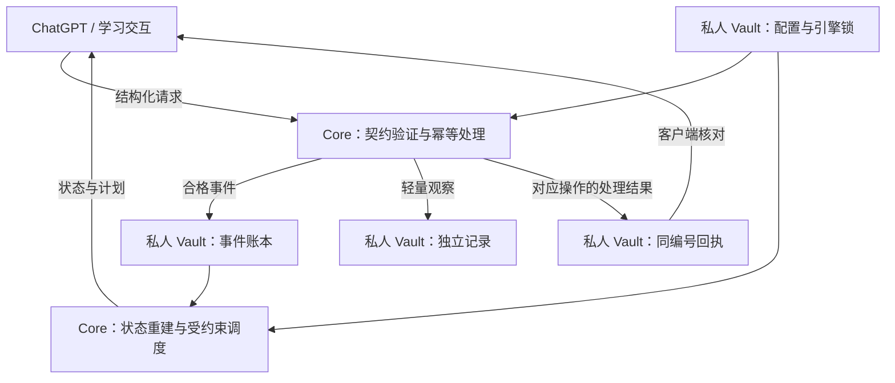

# Postgrad Study Engine

[简体中文](README.md) · [English](README.en.md)

**An Open, Evidence-Based Learning Engine**

让 AI 从回答问题，走向支持长期、可验证的学习。

[](https://github.com/wysking/postgrad-study-engine/releases)
[](https://github.com/wysking/postgrad-study-engine/actions/workflows/test.yml)
[](.github/workflows/test.yml)
[](LICENSE)
[](LICENSE-DOCS-CC-BY-4.0)

**v0.5.0：从空白档案到教学与预测。** 新增统一学习入口、
九单元虚构课程、14 天重放、可拟合记忆基线、可选 FSRS、先修探针和本地仪表盘。
每位学习者独立保存档案和模型；预测明确区分先验、未校准拟合与实际证据。
已提供可复现的[合成校准检查](docs/CALIBRATION_REPORT_0_5_0.md)；真实人群校准尚未验证。

```sh
python -m scripts.study demo --vault ../fictional-study-demo
python -m scripts.study today --vault ../fictional-study-demo --as-of 2026-08-15T09:00:00Z
```

在干净的 v0.5.0 检出中运行，打开演示目录的 `reports/demo.html`，即可查看
“独立正确仍缺证据 → 第三天失败 → 辅助与独立表现分开 → 后续复测”的虚构过程。
演示会拒绝已有目录，不写入真实档案。[运行与模型说明](docs/LEARNING_MODELS.md)
· [教学 Skill](skills/study-tutor/SKILL.md)。拟合及软件测试不等于已经证明学习效果。

ChatGPT 可以解释一道题，但看懂解释、提示后完成和独立求解，代表不同的学习证据。一次正确也不足以证明长期保持。学习者需要一个能保留真实学习经历、追踪错误与复习依据，并在证据不足时明确保留未知的系统。

Postgrad Study Engine 为此提供开放、可复核、可复用的基础设施：交互层负责教学，Core 负责验证与确定性处理，私人 Vault 保存学习证据和配置。考研是起点；长期目标是让经过验证的学习证据在模型、设备和交互工具变化后，仍尽可能可理解、可迁移、可审查。

**English overview.** This reusable Python Core validates structured learning evidence, preserves an append-only event ledger, rebuilds derived state, and schedules work under explicit constraints. It distinguishes independent performance from assisted success and stores incomplete observations without inventing assessments. Learner data belongs in a separate private Vault. ChatGPT is an interaction layer; this repository does not host a chatbot or an OpenAI API service.

[已实现能力](#what-weve-built--已实现能力) · [版本与进度](#development-status--版本与进度) · [工作原理](#how-it-works--工作原理) · [快速上手](#quick-start--快速上手) · [发展路线](#roadmap--发展路线) · [参与贡献](#community--contributing--参与贡献)

## Vision & Mission · 为什么需要这个系统

让 AI 辅助学习的下一步有真实证据可依，而不只依赖一次对话中的印象。

- **记录学习事实。** 保留实际作答、提示条件、错误与修正；缺失的用时、信心和结果保持未知。
- **区分证据强度。** 理解、回忆、独立求解、迁移、速度与长期保持需要各自的证据。
- **让状态可复核。** 从保留的事件重建摘要，说明复习与任务安排的依据。
- **让数据与交互工具分开。** 通用引擎公开复用，个人资料留在各自的私人 Vault。

这些是系统的设计目标。软件验证不等于已经证明学习效果或考试提分。

## What We've Built · 已实现能力

| 能力 | 对学习者或集成者的意义 | 可核验入口 |
| --- | --- | --- |
| 结构化学习证据与版本化契约 | 用明确对象记录作答与诊断，避免把所有聊天都当成能力提升 | [数据契约](docs/DATA_CONTRACTS.md)、[Schema](schemas/README.md) |
| 独立表现与提示后表现分开 | 辅助或未核验的成功不能冒充合格的独立求解证据 | [v0.3.1 发布复核](docs/RELEASE_REVIEW_0_3_1.md)、[证据测试](tests/test_evidence_qualification.py) |
| 错误诊断与针对性复习 | 从可观察的偏离点出发，区分候选错因、确认与延迟核验 | [错误闭环协议](docs/ERROR_CLOSURE_PROTOCOL.md) |
| 只追加事件与确定性状态重建 | 历史可追溯，派生摘要可从事件账本复算 | [数据契约](docs/DATA_CONTRACTS.md)、[重建实现](scripts/reducer.py) |
| 受约束的跨学科调度 | 按时间预算、阶段、先修条件和到期时间选择任务并解释取舍 | [调度说明](docs/GLOBAL_SCHEDULER.md) |
| 结构化移动请求与匹配回执 | 用对应操作的处理结果判断归档，重复请求保持幂等 | [请求与回执](docs/MOBILE_REQUESTS.md) |
| 公共 Core 与私人 Vault 分离 | 复用引擎无需公开个人学习历史或采用别人的学习计划 | [跨端工作流](docs/MOBILE_DESKTOP_WORKFLOW.md) |
| 轻量学习记录，v0.4.0 | 没有完整评估也能保存真实观察，不补造能力判断 | [轻量记录契约](docs/LIGHTWEIGHT_STUDY_RECORDS.md) |

例如，学习者只留下“做过这道题，但结果和提示情况没有记录”，v0.4.0 可以保存这条事实。它不会据此增加正式作答次数、更新掌握度、安排复习或自动排队评估。

## Development Status · 版本与进度

**当前公开版本：[v0.5.0](https://github.com/wysking/postgrad-study-engine/releases/tag/v0.5.0)。** 核心基础设施已建立，可靠性与使用体验仍在持续完善；当前主要提供契约、Python 工具、协议和集成工作流。

| 公开版本 | 阶段成果 | 发布依据 |
| --- | --- | --- |
| v0.3.0 | 建立公共 Core、数据契约、移动请求处理、状态重建与学习调度 | [Release](https://github.com/wysking/postgrad-study-engine/releases/tag/v0.3.0) |
| v0.3.1 | 加强独立证据资格、诊断闭环、调度门槛、一致性与失败恢复 | [Release](https://github.com/wysking/postgrad-study-engine/releases/tag/v0.3.1)、[复核记录](docs/RELEASE_REVIEW_0_3_1.md) |
| v0.4.0 | 增加独立存储的轻量观察记录，同时保持原有正式事件契约 | [Release](https://github.com/wysking/postgrad-study-engine/releases/tag/v0.4.0)、[发布说明](docs/RELEASE_NOTES_0_4_0.md) |
| v0.5.0 | 统一学习入口、个体记忆拟合、可选 FSRS、先修探针、教学适配与合成校准检查 | [Release](https://github.com/wysking/postgrad-study-engine/releases/tag/v0.5.0)、[发布与复核](docs/RELEASE_NOTES_0_5_0.md) |

v0.4.0 发布验证记录包含 **136 项使用虚构数据的单元与集成测试**，其中包括 18 项轻量记录边界与恢复检查，并在 Linux、Windows CI 上验证。这是该版本的发布记录；v0.5.0 的复核与边界见[发布记录](docs/RELEASE_REVIEW_0_5_0.md)，当前运行结果请查看上方 CI。测试验证软件行为，不证明长期学习效果。

公共版本发布与私人 Vault 采用是两件事。每个 Vault 以自己的 `engine.lock.json` 锁定精确提交；升级需要独立审核，发布新版不会自动改变使用者的运行版本。完整变化见 [CHANGELOG](CHANGELOG.md)。

## How It Works · 工作原理



ChatGPT 等交互工具负责讲解、提问、观察作答和提出候选错因。Core 在客户端或工作流调用时执行确定性规则；私人 Vault 提供个人资料、学科配置、证据和运行版本。图中是结构化集成流程，连线不代表本仓库已托管 ChatGPT 服务或实现自动 API 调用。

轻量观察独立存储，不进入能力状态或调度。客户端核对同编号回执的操作、请求哈希与预期事件或记录后，才能确认对应结果。`succeeded` 表示对应操作成功；`project_change_request` 的 `pending` 仅表示建议已登记、仍待审核；`failed` 不代表归档成功。详细规则见 [移动请求文档](docs/MOBILE_REQUESTS.md)。

## Quick Start · 快速上手

需要 Git 和 Python；CI 使用 **Python 3.12**。运行时仅依赖 Python 标准库。

### 1. 获取已发布版本并验证

```sh
git clone --branch v0.5.0 https://github.com/wysking/postgrad-study-engine.git
cd postgrad-study-engine
python -m unittest discover -s tests -v
python -m scripts.validate_events
```

默认演示账本为空；校验空账本用于检查安装与契约入口，不代表已经导入学习数据。

### 2. 跑通一个虚构示例

以下命令在 Git Bash、常见 Unix shell 或 PowerShell 中可运行。从仓库根目录执行，输出仅写入已忽略的 `state/local/readme-demo/` 演示目录。首次运行请使用空的演示目录；示例身份固定，重复追加同一事件会被拒绝。

```sh
python -m scripts.append_event --event examples/attempt_clean_correct.json --events state/local/readme-demo/events.jsonl
python -m scripts.validate_events --events state/local/readme-demo/events.jsonl
python -m scripts.rebuild_state --events state/local/readme-demo/events.jsonl --units state/knowledge_units.json --output state/local/readme-demo/derived_state.json
python -m scripts.schedule_global --state state/local/readme-demo/derived_state.json --request examples/schedule_request.json --config config/scheduler.json --output state/local/readme-demo/schedule.json
```

预期结果：追加并校验 1 条虚构事件，重建包含 1 个知识单元的状态，再生成演示计划。查看 `derived_state.json` 和 `schedule.json`，可看到证据摘要、入选任务、时间预算和排除原因。单次独立正确仍不足以得到整体掌握结论。

演示请求中的时间、候选与学习表现全部虚构，不能复制进真实学习历史或当作当前学习计划。另可运行 `python -m unittest tests.test_cli_workflow -v`，在自动清理的临时目录中验证完整 CLI 流程。

### 3. 接入自己的私人 Vault

首次接入请从[分步指南（中英双语）](docs/GETTING_STARTED.md)开始：准备空白 Vault、锁定运行提交、检查配置，再用不新增学习事件的计划请求验证请求与回执闭环。

开发者先阅读 [跨端工作流](docs/MOBILE_DESKTOP_WORKFLOW.md)、[请求契约](docs/MOBILE_REQUESTS.md) 和 [迁移说明](migrations/README.md)，准备自己的私有配置、数据与精确引擎锁。以下命令中的相邻路径需替换为已配置的 Vault：

```sh
python -m scripts.process_inbox --vault-root ../private-vault
```

这是面向集成者的入口，尚无一键创建并托管个人学习系统的安装器。启用轻量记录还需要该 Vault 支持记录持久化并采用兼容的锁定版本，见 [采用与回退要求](docs/LIGHTWEIGHT_STUDY_RECORDS.md#adoption-rollback-and-later-assessment)。

## Roadmap · 发展路线

以下区分现有能力、已有研究方向与长期产品设想，不代表交付日期或效果承诺。

| 阶段 | 状态 | 方向与验收依据 |
| --- | --- | --- |
| 1. 可信学习记录基础 | 核心能力已实现，持续完善 | 保留真实证据、独立表现、诊断与复习依据；以 v0.3.x–v0.4.0 的契约、重放与边界测试验证行为 |
| 2. 个体模型与学习安排 | v0.5.0 已实现实验模型，真实校准待验证 | 个体半衰期拟合、时序评估、可选 FSRS 与先修探针；下一步验证人群迁移、动态保持率和实际调度效果 |
| 3. 可复用的 AI 学习基础设施 | 已有 CLI、教学 Skill 与 OpenAI 适配，持续建设 | 扩展真实课程、便利部署与接入体验；多用户托管及长期学习效果仍需独立建设和验证 |

阶段 2 的详细方向与升级门槛见 [记忆与调度模型路线图](docs/MEMORY_AND_SCHEDULING_MODEL_ROADMAP.md)：保留历史事件，对比当前确定性基线，提供重放测试、可复现输出和回滚路径。未经校准的分数不能称作掌握概率或保证提分。

阶段 3 已有本地入口，托管应用与自动远端部署仍属后续范围。新增服务、接口或模型需要单独提案与评审。[真实思维证据设计 PR #3](https://github.com/wysking/postgrad-study-engine/pull/3) 也是独立草案，不是当前生效契约或已上线的能力。

## Principles & Limitations · 原则与边界

- **证据先于判断。** 不把 AI 补全写成学习者原始步骤；事后澄清与当时作答分开，系统推断明确标注。来源是否真实仍依赖如实观察与客户端核验。
- **未知保持未知。** 辅助成功、独立成功、迁移、实测速度与延迟保持不能互相替代；近期正确不等于稳定掌握。
- **历史只追加。** 状态可以重建，历史事件不因模型升级而重写；不兼容契约需要版本化迁移与兼容性验证。
- **私人资料留在 Vault。** 公共仓库仅包含通用契约、工具、空白配置与虚构示例，不收录真实学习经历、完整聊天、原始图片或教材内容。
- **确定性不等于无条件可靠。** 当前多文件发布可处理捕获到的错误，但不具备数据库式的崩溃原子性；独立工作流运行器仍需串行处理。恢复与回执规则见 [请求文档](docs/MOBILE_REQUESTS.md)。
- **效果尚需验证。** 当前调度是透明启发式，不是已校准的学习模型，也不声称数学上的全局最优；尚未证明考试提分或长期学习改善。本项目无 OpenAI 官方认证或背书。

## Community & Contributing · 参与贡献

欢迎从文档可读性、可复现的问题报告、虚构边界示例与测试入手。通过 [Issues](https://github.com/wysking/postgrad-study-engine/issues) 提交问题或建议，通过 [Pull Requests](https://github.com/wysking/postgrad-study-engine/pulls) 参与评审和贡献。

报告问题时说明运行版本、预期与实际行为，并提供最小的**虚构**复现材料。不要上传私人 Vault、真实回执、个人作答或第三方付费资料。

修改前阅读 [AGENTS.md](AGENTS.md) 和 [维护交接流程](docs/PROJECT_ITERATION_HANDOFF.md)。代码、Schema 与学习协议变更按现有流程提出变更请求，再经 PR 评审；私人 Vault 的版本采用另行审核。提交修改前运行上述测试与账本校验。

### 技术文档导航

| 主题 | 入口 |
| --- | --- |
| 首次接入 | [分步指南（中英双语）](docs/GETTING_STARTED.md) |
| 数据与运行工具 | [数据契约](docs/DATA_CONTRACTS.md)、[Schema](schemas/README.md)、[脚本](scripts/README.md) |
| 教学与错误处理 | [学习会话协议](docs/STUDY_SESSION_PROTOCOL.md)、[错误闭环](docs/ERROR_CLOSURE_PROTOCOL.md) |
| 移动集成与记录 | [跨端工作流](docs/MOBILE_DESKTOP_WORKFLOW.md)、[请求与回执](docs/MOBILE_REQUESTS.md)、[轻量记录](docs/LIGHTWEIGHT_STUDY_RECORDS.md) |
| 调度与未来模型 | [全局调度器](docs/GLOBAL_SCHEDULER.md)、[模型路线图](docs/MEMORY_AND_SCHEDULING_MODEL_ROADMAP.md) |
| 发布与维护 | [CHANGELOG](CHANGELOG.md)、[v0.3.1 复核](docs/RELEASE_REVIEW_0_3_1.md)、[v0.4.0 说明](docs/RELEASE_NOTES_0_4_0.md)、[迁移说明](migrations/README.md) |

## Licensing · 许可

- Python 代码采用 **MIT**，见 [LICENSE](LICENSE)。
- 文档、协议、Schema 与模板采用 **CC BY 4.0**，见 [LICENSE-DOCS-CC-BY-4.0](LICENSE-DOCS-CC-BY-4.0)。
- 第三方教材、付费课程、扫描件、题库及其他来源作品不包含在本仓库中，也不因引用而被本项目重新授权。参见 [NOTICE](NOTICE.md)。
