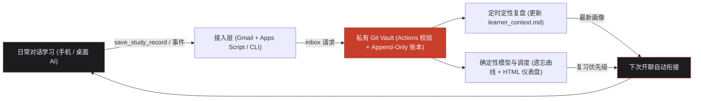

<div align="center">


<br />
<br />

# Postgrad Study Engine

**让每一次提问与推导，都沉淀为下一次学习的起点。**

<sub>面向考研与长期自学的开源 Git 驱动 AI 学习引擎 · 开放记录 · 定期画像 · 记忆拟合 · 约束调度</sub>

<br />

[](https://github.com/wysking/postgrad-study-engine/releases)
[](https://github.com/wysking/postgrad-study-engine/actions/workflows/test.yml)
[](scripts/study.py)
[](LICENSE)
[](LICENSE-DOCS-CC-BY-4.0)

<br />

**简体中文** · [English](README.en.md)
&nbsp;&nbsp;|&nbsp;&nbsp;
[核心特性](#features) · [系统闭环](#architecture) · [三层记忆](#memory) · [快速体验](#quickstart) · [接入模式](#modes) · [文档导航](#docs)

</div>

---

## ✨ 为什么做这个项目？

用 AI 辅助刷题和自学时，最可惜的往往不是“没听懂”，而是**聊完就忘、换个窗口一切归零**。

<table>
  <thead>
    <tr>
      <th width="22%">维度</th>
      <th width="39%">传统 AI 对话刷题</th>
      <th width="39%">Postgrad Study Engine</th>
    </tr>
  </thead>
  <tbody>
    <tr>
      <td><b>长期记忆</b></td>
      <td>分散在几十个聊天窗口里，新对话从零介绍背景</td>
      <td>私有 Git 账本持续累积，每次开聊自动载入最新学习画像</td>
    </tr>
    <tr>
      <td><b>记录方式</b></td>
      <td>要么全靠手写复盘太耗时，要么不记直接流失</td>
      <td>对话中顺手保存真实经过，简题一句话、难题保留完整推导</td>
    </tr>
    <tr>
      <td><b>掌握判断</b></td>
      <td>看懂解析、提示做对与独立做出混为一谈</td>
      <td>底层严格区分独立求解、提示完成与错因诊断，拒绝虚假掌握</td>
    </tr>
    <tr>
      <td><b>迁移与隐私</b></td>
      <td>数据锁死在单一平台，换模型就断档</td>
      <td>公开 Core 与私有 Vault 分离，纯文本 JSON/Markdown 永久归你</td>
    </tr>
  </tbody>
</table>

---

<a id="features"></a>

## 🧩 核心特性

<table>
  <tr>
    <td width="50%" valign="top">
      <h3>01 · 无感记录，保留真实思考</h3>
      <p>日常默认采用开放式事实记录（<code>save_study_record</code>），不打断做题节奏、不要求填写繁琐表单。简单题一句带过，复杂推导完整保留最初思路、提示顺序、局部卡点与自我修正。</p>
    </td>
    <td width="50%" valign="top">
      <h3>02 · Core 与 Vault 彻底分离</h3>
      <p>本仓库提供公开可复用的校验契约、状态重建、调度器与测试套件；个人资料、原始账本与学习画像全部保存在你的私有 Vault 仓库，换设备、换 AI 客户端无缝延续。</p>
    </td>
  </tr>
  <tr>
    <td width="50%" valign="top">
      <h3>03 · 全云端、零服务器闭环</h3>
      <p>支持纯本地 CLI，也可搭配私有 GitHub Actions 与原生云端桥接（Google Drive 只读镜像 + Gmail 草稿 + Apps Script 定时同步），手机随时学、自动入库并完成夜间复盘，无需服务器或付费大模型 API。</p>
    </td>
    <td width="50%" valign="top">
      <h3>04 · 可追溯、可重建的工程底座</h3>
      <p>事件账本采用 append-only 设计，内置幂等去重、同 ID 精确回执与单写入者并发保护；支持确定性状态重建、多学科约束调度，以及可选遗忘曲线拟合与 FSRS 模块。</p>
    </td>
  </tr>
</table>

---

<a id="architecture"></a>

## 🔄 系统闭环



---

<a id="memory"></a>

## 🗂️ 三层记忆架构

记录与分析彻底解耦——**保存事实不依赖分析成功**，日常学习零等待，后台分析按需运行：

| 层级 | 核心文件 | 存什么 / 产出什么 | 使用节奏 |
| :--- | :--- | :--- | :--- |
| **L1 · 开放式学习记录** | `records/study_records.jsonl` | 题目背景、真实思路、提示顺序、错因修正与已知时间 | 平时随手保存，轻量无负担 |
| **L2 · 定性学习画像** | `analysis/learner_context.md`<br>`analysis/daily/YYYY-MM-DD.md` | 跨记录的阶段进展、高频局部卡点、有效讲解方式与溯源引用 | 每日 / 每周定时复盘，下次对话直接读取 |
| **L3 · 正式证据与模型** | `events/learning_events.jsonl`<br>`state/` · `exports/` | 严格区分独立作答与辅助完成的评估事件、六维证据、遗忘风险与复习排程 | 阶段诊断、变式复测与全局时间分配 |

<details>
<summary><b>👀 展开查看一条开放记录的真实格式（简洁、可读、无多余表单）</b></summary>

```json
{
  "schema_version": "1.0",
  "request_id": "mobile-20261121-math-chain-rule-001",
  "created_at": "2026-11-21T20:15:00+08:00",
  "operation": "save_study_record",
  "client": "mobile",
  "payload": {
    "summary": "练习复合函数求导，初稿漏乘内层导数；提醒链式法则后独立补全并算对，随后口头复述了外层到内层的逐层展开顺序。",
    "subject_label": "math",
    "topic": "复合函数求导与链式法则",
    "occurred_on": "2026-11-21"
  }
}
```

</details>

---

<a id="quickstart"></a>

## ⚡ 1 分钟快速体验

仅需 **Git** 与 **Python 3.12**（核心引擎基于 Python 标准库，零第三方依赖）：

```sh
git clone --branch v0.5.1 https://github.com/wysking/postgrad-study-engine.git
cd postgrad-study-engine
python -m scripts.study demo --vault ../study-demo
```

> [!TIP]
> 运行完成后打开 `../study-demo/reports/demo.html`，即可浏览一段跨 14 天的示例学习轨迹，直观体验独立求解、提示后修正、错因诊断、状态重建与复习优先级排程的完整仪表盘。

---

<a id="modes"></a>

## 🚀 三种接入模式

按照 [首次接入指南](docs/GETTING_STARTED.md) 创建你的空白私有 Vault 后，可按需选择或组合以下模式：

<table>
  <tr>
    <td width="33%" valign="top">
      <h4>💻 本地 CLI 模式</h4>
      <p>纯 Python 标准库即开即用。通过 <code>python -m scripts.study</code> 保存记录、重建状态、查看今日建议并导出离线 HTML 报告。</p>
      <p><a href="docs/GETTING_STARTED.md">查看本地上手 →</a></p>
    </td>
    <td width="33%" valign="top">
      <h4>📱 云端移动闭环（推荐）</h4>
      <p>私有 Vault 配合 GitHub Actions 单写入工作流，搭配 <b>Google Drive 镜像 + Gmail 草稿 + Apps Script</b> 每 5 分钟自动桥接，电脑关机也能手机学习与夜间自动复盘。</p>
      <p><a href="docs/EVERYDAY_LEARNING.md">查看云端配置 →</a></p>
    </td>
    <td width="33%" valign="top">
      <h4>🔧 协议与学科扩展</h4>
      <p>开放 9 类标准 <code>inbox</code> 操作与完整 JSON Schema，支持自由对接任意 AI 客户端、编排自定义课程先修图与针对性诊断探针。</p>
      <p><a href="docs/MOBILE_REQUESTS.md">查看请求协议 →</a></p>
    </td>
  </tr>
</table>

---

## 📦 核心能力一览（v0.5.1）

| 模块 | 已提供能力 |
| :--- | :--- |
| **开放式记录** | `save_study_record` 轻量入库，支持自由文本、学科标签、主题、来源引用与发生日期 |
| **证据与诊断闭环** | 严格区分独立作答、辅助完成、猜测与诊断修订，支持同构 / 迁移变式检验 |
| **跨端请求协议** | 9 类标准 `inbox` 操作，内置幂等去重、单写入者并发锁与 `outbox` 精确回执 |
| **状态、模型与调度** | 确定性状态重建、多学科约束优先级调度，以及可选遗忘曲线拟合与 FSRS 模块 |
| **报告与工程保障** | CLI 统一入口、上下文胶囊导出、独立 HTML 学习仪表盘与完整单元测试套件 |

---

<a id="docs"></a>

## 📚 文档导航

| 想了解什么 | 推荐阅读 |
| :--- | :--- |
| **从零搭起自己的学习系统** | [首次接入指南](docs/GETTING_STARTED.md) · [日常使用与定期复盘](docs/EVERYDAY_LEARNING.md) |
| **跨端同步与移动请求协议** | [跨端工作流](docs/MOBILE_DESKTOP_WORKFLOW.md) · [移动请求规范](docs/MOBILE_REQUESTS.md) · [开放记录契约](docs/LIGHTWEIGHT_STUDY_RECORDS.md) |
| **数据契约、学习模型与调度** | [数据契约](docs/DATA_CONTRACTS.md) · [Schema 目录](schemas/README.md) · [学习模型说明](docs/LEARNING_MODELS.md) · [全局调度](docs/GLOBAL_SCHEDULER.md) |
| **版本演进与参与贡献** | [变更日志](CHANGELOG.md) · [模型路线图](docs/MEMORY_AND_SCHEDULING_MODEL_ROADMAP.md) · [仓库开发规范](AGENTS.md) |

---

<div align="center">

欢迎通过 [Issues](https://github.com/wysking/postgrad-study-engine/issues) 交流想法或提交 [Pull Requests](https://github.com/wysking/postgrad-study-engine/pulls)。

代码基于 [MIT](LICENSE) 开源 · 文档、协议与 Schema 基于 [CC BY 4.0](LICENSE-DOCS-CC-BY-4.0) 许可 · 第三方署名见 [NOTICE.md](NOTICE.md)

</div>
