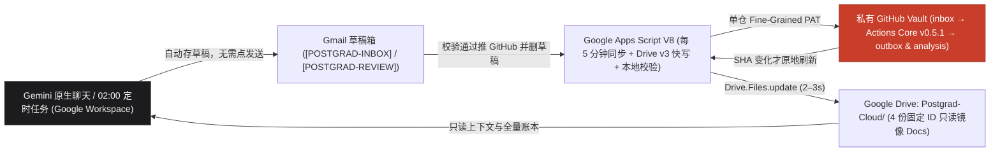

# Dual AI Integrations: Gemini & ChatGPT / Codex · 双生态 AI 接入方案

[简体中文首页](../README.md) · [English README](../README.en.md) · [English Overview](#english-dual-ai-integration-guide)

**Postgrad Study Engine** 将学习记忆放在你自己的私有 GitHub Vault 中（纯文本 JSONL + Markdown，统一 `Schema 1.0`）。  
因为存储与校验完全解耦，你可以自由选用 **两套现成、可复制部署的云端 AI 接入方案**（也可随时混用或无缝切换，记忆零断档）：

---

## 两套云端接入方案一览

| 维度 | 方案 A：Gemini 原生全谷歌桥接（推荐） | 方案 B：ChatGPT / OpenAI / Codex 接入 | 方案 C：纯本地 CLI |
| :--- | :--- | :--- | :--- |
| **适用人群** | Google AI Pro / 原生 Gemini 网页与手机 App 用户 | ChatGPT Plus/Pro（带 GitHub 连接器 / Scheduled）或 Codex 用户 | 偏好离线、命令行与任意本地/第三方模型用户 |
| **大模型成本** | 复用现有 Gemini 订阅，**零付费 Developer API** | 复用现有 ChatGPT / Codex 订阅 | 零 API 成本（纯 Python 标准库） |
| **手机端读写通道** | **第一方 Google Drive（只读镜像）+ Gmail 草稿（上行）**，零第三方远程 MCP | GitHub Connector / Custom Action 直接读写 `inbox/` 与 `outbox/` | 本机命令行 `python -m scripts.study` |
| **后台同步机制** | 个人账号免费 **Google Apps Script V8**（每 5 分钟单向同步，Drive v3 原地快写） | 直连 GitHub REST / GitHub Actions | 本地 Git 手动或定时同步 |
| **安全边界** | 零 GCP 绑卡、零 Service Account、零公网 `doPost`、单仓 Fine-Grained PAT + 本地白名单校验 | 私有仓受控权限 + Actions 单写入并发锁 | 全本地文件系统 |
| **夜间定性复盘** | Gemini Scheduled Actions（如每天 02:00）读 Drive 账本 → 存 `[POSTGRAD-REVIEW]` 草稿 → Apps Script 原子提交 | ChatGPT Scheduled Task 读 GitHub 账本 → 原子发布 `analysis/daily/` 与 `learner_context.md` | 本地或自定义脚本运行 |
| **直接复制模板** | 👉 [integrations/google-native-bridge/](../integrations/google-native-bridge/) | 👉 [skills/study-tutor/SKILL.md](../skills/study-tutor/SKILL.md) + [日常复盘指南](EVERYDAY_LEARNING.md) | 👉 [首次接入指南](GETTING_STARTED.md) |

---

## 方案 A：Gemini 全谷歌原生桥接架构（零远程 MCP）

针对远程第三方 GitHub MCP 在手机端和后台定时任务中容易断连的问题，方案 A 让 Gemini **只通过 Google 第一方原生连接器读写 Google Drive 和 Gmail**，再由你自己 Google 账号免费托管的 Apps Script 单向同步私有 GitHub 仓库：

### 开箱即用的完整文件（全部在仓库内，可直接复制部署）
1. **[`integrations/google-native-bridge/Code.gs`](../integrations/google-native-bridge/Code.gs)**：单文件 Apps Script V8 桥接器（内置一键 `setupBridge()`、5 分钟 `runBridgeCycle()`、Drive v3 防超时覆写、弯引号安全检测、Core v0.5.1 Schema 校验、冲突保护与 `outbox` 回执短轮询）。
2. **[`integrations/google-native-bridge/appsscript.json`](../integrations/google-native-bridge/appsscript.json)**：声明启用 `Drive` v3 高级服务与最小 OAuth 权限，无任何 `webapp`/`doPost`。
3. **[`integrations/google-native-bridge/GEMINI_TUTOR_SKILL.md`](../integrations/google-native-bridge/GEMINI_TUTOR_SKILL.md)**：日常辅导 Skill / Gem 指令模板。
4. **[`integrations/google-native-bridge/GEMINI_DAILY_REVIEW_PROMPT.md`](../integrations/google-native-bridge/GEMINI_DAILY_REVIEW_PROMPT.md)**：每日 02:00 定性复盘定时任务提示词模板。
5. **[`integrations/google-native-bridge/README.md`](../integrations/google-native-bridge/README.md)**：5 分钟保姆级点击部署清单。

---

## 方案 B：ChatGPT / OpenAI / Codex 接入架构

如果你日常使用 **ChatGPT（移动端 / 网页端 + Scheduled）** 或 **Codex**：

1. **日常辅导与归档**：
   - 将仓库内置的通用私教 Skill [skills/study-tutor/SKILL.md](../skills/study-tutor/SKILL.md) 加载到 Codex 或作为 ChatGPT 自定义指令。
   - 对话开始读取私有 Vault 中的 `analysis/learner_context.md` 与 `exports/latest.md`；记录学习经过时直接向私有 Vault 写入 `inbox/<request_id>.json`，由 GitHub Actions 检出锁定版 Core 完成校验、落盘并回写 `outbox/<request_id>.json`。
2. **定时定性复盘**：
   - 按照 [docs/EVERYDAY_LEARNING.md](EVERYDAY_LEARNING.md) 配置云端 Scheduled GPT 任务（如每天 02:00），读取完整 `records/study_records.jsonl` 与 `events/learning_events.jsonl`，仅更新 `analysis/daily/YYYY-MM-DD.md` 与 `analysis/learner_context.md`。
3. **可选本地建模与 API 辅助**：
   - 详见 [docs/LEARNING_MODELS.md](LEARNING_MODELS.md) 与 [docs/MOBILE_DESKTOP_WORKFLOW.md](MOBILE_DESKTOP_WORKFLOW.md)。

---

## 为什么两套方案可以随时无缝切换？

无论是通过 **Gemini（Google Drive + Gmail + Apps Script）** 还是 **ChatGPT / Codex（GitHub 连接器 / CLI）**，最终落盘到私有 Git Vault 的都是同一套标准契约：
- 相同的 `inbox/<request_id>.json` & `outbox/<request_id>.json`（`Schema 1.0`）
- 相同的 append-only `records/study_records.jsonl` 与 `events/learning_events.jsonl`
- 相同的 `analysis/learner_context.md` 学习画像与 `state/derived_state.json` 确定性状态

你可以手机用 Gemini、电脑用 Codex，或者随时更换主力 AI，长期记忆与遗忘曲线始终连续不丢。

---

## English Dual AI Integration Guide

Because **Postgrad Study Engine** separates the public Core from your private Git Vault (`Schema 1.0`), you can connect **either (or both)** major AI ecosystems without vendor lock-in:

1. **Track A — Gemini Google-Native Bridge ([`integrations/google-native-bridge/`](../integrations/google-native-bridge/))**
   - Uses first-party **Google Drive** (4 fixed-ID read-only mirror Docs updated in place via Drive API v3) and **Gmail Drafts** (`[POSTGRAD-INBOX]` / `[POSTGRAD-REVIEW]`) bridged every 5 minutes by a free personal **Google Apps Script V8** script.
   - Zero paid LLM API, zero remote GitHub MCP, zero GCP billing, zero Service Account, zero public `doPost` Web App, single-repo GitHub Fine-Grained PAT, and 11 passing Node.js unit tests (`node --test integrations/google-native-bridge/tests/bridge.test.mjs`).
2. **Track B — ChatGPT / OpenAI / Codex ([`skills/study-tutor/SKILL.md`](../skills/study-tutor/SKILL.md) & [`docs/EVERYDAY_LEARNING.md`](EVERYDAY_LEARNING.md))**
   - Connect Codex or ChatGPT (with GitHub connector + Scheduled tasks) directly to your private Vault's `inbox/<request_id>.json` workflow and `analysis/learner_context.md` qualitative review loop.
3. **Track C — Pure Local CLI ([`docs/GETTING_STARTED.md`](GETTING_STARTED.md))**
   - Run `python -m scripts.study` offline with Python 3.12 standard library only.
