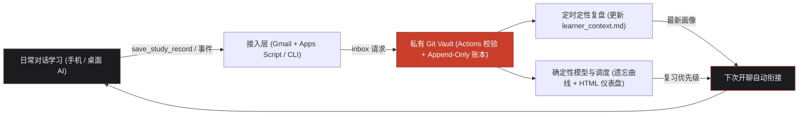

# Architecture & Technical Overview · 架构与技术详述

[简体中文首页](../README.md) · [English README](../README.en.md) · [English Section](#english-technical-overview)

本文档完整收录原本放在仓库首页的详细技术机制、能力矩阵、三层数据边界与常见问题解答。

---

## 一、日常工作流（4 步闭环）



### 1. 照常提问、做题、讨论

可以发一道题、检查自己的步骤、追问一个概念，也可以直接给出完整解法。AI 按当前问题讲解和反馈；需要时再做针对性练习。

### 2. 当场保存真实经过

一道直接做出的题，可以只有简短记录。经历了几轮尝试的题，可以保留最初构造、关键推导、接受过的提示、系数错误以及后来的理解。有真实用时就记录，没有就留空。保存前不要求补齐一份评估清单。

示例记录：

> 今天练习复合函数求导，最初漏乘内层导数。AI 提醒链式法则后，我补上了这一项，重新计算得到正确结果。用时没有记录。

```json
{
  "schema_version": "1.0",
  "request_id": "mobile-20261121-math-chain-rule-001",
  "created_at": "2026-11-21T20:15:00+08:00",
  "operation": "save_study_record",
  "client": "mobile",
  "payload": {
    "summary": "练习复合函数求导，初稿漏乘内层导数；提醒链式法则后独立补全并算对，随后口头复述了外层到内层的逐层展开顺序。",
    "subject_label": "math",
    "topic": "复合函数求导与链式法则",
    "occurred_on": "2026-11-21"
  }
}
```

### 3. 定期回看，更新对学习者的理解

配置独立的定期复盘任务后，它可以阅读累积记录，关联同一道题的不同阶段，整理近期进步、反复出现的问题和仍需观察的地方，更新一份有来源依据的文字学习画像（`analysis/learner_context.md`）。复盘可以按每天或其他适合自己的周期运行。

### 4. 下次带着上下文继续

新对话读取最新画像和当前问题需要的记录。AI 据此选择更合适的解释、提示或复习内容；学习者随时可以纠正它。原始记录继续保留，后续判断可以修订。详见[日常使用与复盘配置](EVERYDAY_LEARNING.md)。

---

## 二、记录、画像和数值模型分别做什么

| 部分 | 保存或生成什么 | 什么时候使用 |
| --- | --- | --- |
| **开放式学习记录** (`records/study_records.jsonl`) | 真实题目背景、实际步骤、提示、错误、修正，以及已知的时间等信息 | 平时随手保存；内容可以简短，也可以详细 |
| **定性学习画像** (`analysis/learner_context.md` / `daily/`) | 对多条记录的关联理解、近期表现、教学建议和待验证判断 | 单独复盘；供后续对话参考 |
| **正式事件与数值模型** (`events/` / `state/` / `exports/`) | 满足评估契约的作答证据、可重建状态、记忆与技能参考 | 需要正式评估、模型分析或调度时使用 |

**保存记录不依赖分析成功。** 定性画像和数值模型分别运行；当前数值模型主要读取正式事件，开放记录不会自动变成掌握度分数。一次提示后做对，也不会被记成独立完成或长期掌握。

---

## 三、Core 能力与模块状态（v0.5.1）

公开的 **Core** 提供通用工具，每位使用者自己的 **Vault** 保存私人学习资料。二者分开，可以在更换设备或交互工具时继续使用自己的档案。

| 能力 | 当前状态 |
| --- | --- |
| 开放式事实记录 | 已实现；通过 `save_study_record` 独立保存，无需完整评估 |
| 正式学习证据与状态重建 | 已实现；区分独立作答、辅助表现和诊断证据 |
| 重复请求处理与保存确认 | 已实现；由工具和工作流处理，日常成功确认可简短显示“已记录” |
| 本地演示、命令行和 HTML 报告 | v0.5.0+ 已提供（`python -m scripts.study demo`） |
| 课程先修关系与针对性探针 | 已提供契约（`schemas/course_package.schema.json`）和示例 |
| 记忆拟合、可选 FSRS 与技能参考 | v0.5.0+ 提供半衰期遗忘曲线拟合、可选 FSRS 与技能参考（参见[校准报告](CALIBRATION_REPORT_0_5_0.md)） |
| 定期阅读记录并更新文字画像 | 提供[接入方案](EVERYDAY_LEARNING.md)，支持云端定时任务或本地运行 |

---

## 四、搭建自己的学习档案（三种运行方式）

从[首次接入指南](GETTING_STARTED.md)建立空白私人 Vault，再选择适合自己的使用方式：

- **本地 CLI 使用**：用 `python -m scripts.study` 保存记录、查看状态和生成离线 HTML 报告。
- **日常云端对话使用**：将 AI 交互工具连接到自己的存储与归档工作流（如私有 GitHub Actions + Google Drive 镜像 / Gmail 草稿 / Apps Script 定时桥接），正常教学时自动保存实际经过。
- **定期复盘**：给独立复盘任务读取记录、更新 `analysis/` 分析文件的权限，设置周期；后续对话读取最新画像。具体配置见[日常使用指南](EVERYDAY_LEARNING.md)。

---

## 五、常见问题（FAQ）

### 1. 每道题都要记录用时、信心、错因吗？
不需要。保存实际知道的内容即可。AI 可以从对话中整理事实，无需为了归档追问一堆字段，也不补造缺失的信息。

### 2. 记录详细过程，会不会拖慢平时学习？
记录沿用已经发生的学习内容。直接完成就简记，有多轮推导就尽量保留关键过程。分析放在独立复盘中；分析失败也不影响已经保存的记录。请求编号等技术细节由集成处理。

### 3. AI 会自动理解所有保存的记录吗？
保存与复盘解耦。给复盘任务接入原始记录（`records/study_records.jsonl` 与 `events/learning_events.jsonl`），设置明确的阅读范围和输出位置（`analysis/learner_context.md`），后续对话即可读取更新后的画像。

### 4. 有了文字画像，掌握度分数也会自动更新吗？
不会。文字画像提供可修订的教学理解；正式数值评估有自己的证据条件和计算入口。它们可以参考同一段学习经历，但不会把同一题的草稿、提示和修正当成多次独立成功。

### 5. 适用于考研以外的学习吗？
考研（Kaoyan）是项目的起点。这套长周期记录、遗忘曲线拟合（FSRS / 半衰期）与间隔重复调度架构同样适用于各类长期自学；具体课程、学科先修关系、题目来源和学习计划由使用者在 Vault 中配置。

### 6. 数值模型与校准报告说明什么？
测试和 `fictional-14-days` 演示验证确定性状态重建、遗忘曲线拟合与调度器行为；[合成校准报告](CALIBRATION_REPORT_0_5_0.md)展示合成基准下的模型恢复与校准指标，记忆和技能输出作为可解释的教学参考。

---

## 六、完整开发者文档索引

| 想了解什么 | 文档入口 |
| --- | --- |
| 普通学习与定期复盘如何连接 | [日常使用与复盘](EVERYDAY_LEARNING.md) |
| 初始化、演示和本地使用 | [首次接入](GETTING_STARTED.md)、[学习工具与模型](LEARNING_MODELS.md) |
| 云端归档、请求与持久化 | [跨端工作流](MOBILE_DESKTOP_WORKFLOW.md)、[移动请求](MOBILE_REQUESTS.md)、[开放记录契约](LIGHTWEIGHT_STUDY_RECORDS.md) |
| 正式证据、课程与模型 | [数据契约](DATA_CONTRACTS.md)、[Schema]( ../schemas/README.md )、[全局调度](GLOBAL_SCHEDULER.md)、[错因闭环协议](ERROR_CLOSURE_PROTOCOL.md)、[教学会话协议](STUDY_SESSION_PROTOCOL.md) |
| 发布历史和研究方向 | [CHANGELOG](../CHANGELOG.md)、[模型路线图](MEMORY_AND_SCHEDULING_MODEL_ROADMAP.md)、[v0.5.0 校准报告](CALIBRATION_REPORT_0_5_0.md) |
| 维护与贡献 | [CONTRIBUTING.md](../CONTRIBUTING.md)、[AGENTS.md](../AGENTS.md)、[变更流程](PROJECT_ITERATION_HANDOFF.md) |

---

<a id="english-technical-overview"></a>

## English Technical Overview

### 1. Everyday 4-Step Loop

1. **Ask, solve, and discuss**: Bring a problem, check steps, explore a concept, or present a full solution.
2. **Save what happened**: Use `save_study_record` for frictionless open notes or formal events for assessed attempts. Measured time is optional; no rigid checklist is required before saving.
3. **Review periodically**: A scheduled reviewer reads accumulated records, connects multi-turn stages of the same problem, and updates a source-linked `analysis/learner_context.md`.
4. **Continue with context**: The next conversation loads the latest learner context and relevant history. See the [everyday learning guide](EVERYDAY_LEARNING.md#english-setup-guide).

### 2. Records, Written Context, and Numerical Models

| Part | What It Preserves or Produces | When It Is Used |
| --- | --- | --- |
| **Study records** (`records/study_records.jsonl`) | Actual problem context, steps, hints, mistakes, corrections, and observed timing | Everyday saving; notes may be brief or detailed |
| **Written learner context** (`analysis/learner_context.md`) | Connections across records, recent observations, teaching suggestions, and hypotheses to check | Independent periodic review and future conversations |
| **Formal events & numerical models** (`events/` / `state/`) | Qualified assessment evidence, rebuildable state, half-life / FSRS recall, and skill references | Formal assessment, model analysis, and spaced-repetition scheduling |

**Saving does not depend on analysis succeeding.** Qualitative interpretation and numerical modeling run independently; an assisted success is never counted as solo mastery.

### 3. Capabilities Status (v0.5.1)

| Capability | Current Status |
| --- | --- |
| Open factual records | Implemented via `save_study_record`, independent of formal assessment |
| Formal evidence & state rebuilding | Implemented; solo work, assisted performance, and diagnosis evidence remain distinct |
| Duplicate-request handling & receipts | Implemented in CLI and workflows with exact same-ID `outbox` receipts |
| Local demo, CLI & HTML reports | Available (`python -m scripts.study demo`) |
| Prerequisites & targeted probes | Contracts (`schemas/course_package.schema.json`) and examples included |
| Recall fitting, optional FSRS & skill references | Half-life decay fitting, optional FSRS, and skill estimates ([calibration report](CALIBRATION_REPORT_0_5_0.md)) |
| Periodic review & learner context updates | Documented [setup pattern](EVERYDAY_LEARNING.md#english-setup-guide) for cloud or local runners |

### 4. Frequently Asked Questions

- **Must every problem include timing, confidence, and a diagnosis?** No. Save what was actually observed; unknown measurements remain omitted.
- **Will preserving detail interrupt learning?** No. Notes capture reasoning already produced during the conversation, while analysis runs asynchronously.
- **Does a written context automatically change mastery scores?** No. Written context is revisable teaching guidance; numerical models consume formal events so multi-hint drafts on one question are never double-counted as independent solves.
- **Can it be used beyond Kaoyan?** Yes. While born out of Kaoyan (China's postgraduate entrance exam) preparation, the Core works as a general **long-term memory engine for AI tutors** and a derivation-friendly **Anki alternative** for any technical subject.
