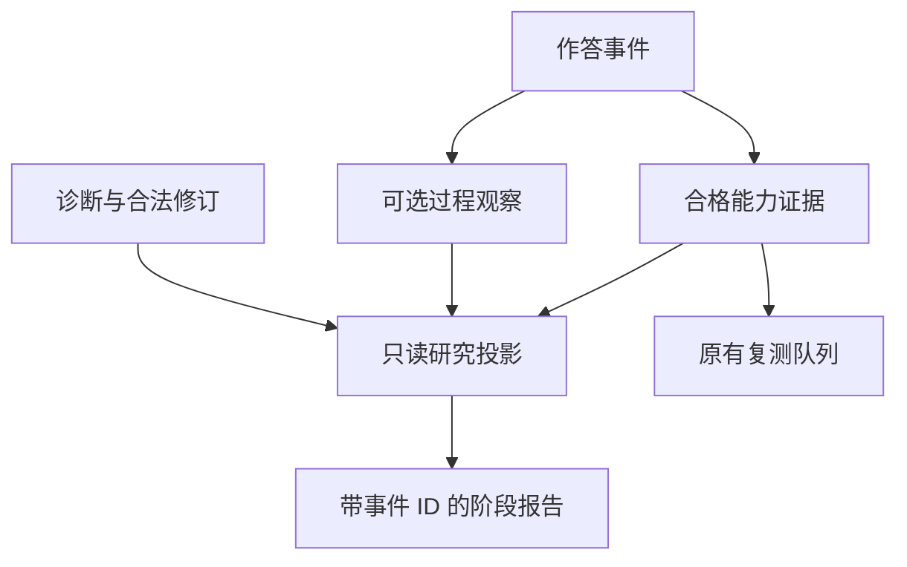

# 思维过程证据契约提案

状态：**设计草稿，未接入运行时**。本目录不是 `schemas/` 的生效契约。当前 Core 只接受事件 1.0；下面的 1.1 是拟议格式，不能提交到当前手机入口。学习事件、诊断、归档、调度仍由现有 Core 负责。本提案不更改权重，不引入 FSRS/BKT/FIRe、能力总分、画像服务或新客户端。

## 1. 研究对象与最小改动

研究对象是**可观察的思维表达及学习行为**，不是不可直接访问的内心全过程。写下一步、解释理由、事后回忆理由和系统推测理由是不同的数据。没写出来不等于没想过；表达流畅不等于推理正确；题目答对也不能证明采取了某一种方法。

保留现有 `attempt`、`diagnosis`、`diagnosis_id`、`supersedes_event_id`、手机批次和同 ID 回执机制。只提议增加一个可选事件类型 `process_observation`，绑定一个已有的作答事件；一次只保存有研究价值的短片段。普通题不必生成它。报告是版本化的派生文件，不再建一套人物特征账本或打分器。

采用附着事件而不是修改旧 `attempt.evidence`，因为：旧记录不能重写；同一段转录可能需要更正；新编码不能假装在作答当时已经存在。事件计数与作答计数必须分开，追加观察不能凭空增加样本。

## 2. 观察维度是编码框架

| 编码 | 可保留的实际证据 | 不能推出的结论 |
| --- | --- | --- |
| `problem_representation` | 用户指出条件、目标、变量、约束或结构 | 系统复述题意不等于用户已理解 |
| `method_entry` | 反馈前选择方法及真实说出的依据 | 后来接受标准方法不等于最初会选 |
| `causal_reasoning` | 将条件、原理和操作联系起来 | 只报公式不能证明理解适用条件 |
| `abstraction` | 用户提出一般结构，并处理适用边界或反例 | 喜欢逻辑推导不等于抽象能力强 |
| `derivation_completeness` | 可核查的关键中间步骤、条件与衔接 | 一张局部照片不能证明整条链完整 |
| `strategy_adjustment` | 原方案、受阻点、后续改变及提示条件 | 教师换法不能记成用户自主换法 |
| `error_monitoring` | 用户在揭错前指出并修正具体偏离 | 教师问“这里错了吗”之后发现错误属于受促发 |
| `independent_reconstruction` | 无相关提示、答案不可见时重建完整链 | 近期看过推导后的重建是另一种证据 |
| `transfer` | 新任务中实际使用前一结构，附变化说明 | 同构换数、`variant` 或跨学科标签本身不是远迁移 |
| `learning_efficiency` | 可归属的实测投入和预先定义的能力终点 | 聊天时间跨度、回复间隔、估计任务时长不是投入 |

不要求十维齐全。一次片段通常标 1—2 个相关维度；不得因为一次正确同时提升全部维度。

## 3. 来源、判断与提示分开

`source.kind` 不随后来验证而改变：

| 值 | 含义 | 研究使用 |
| --- | --- | --- |
| `learner_work` | 当时实际可辨识的书写、打字或口头作答 | 可以说明用户展示了什么；不能还原未表达的原因 |
| `concurrent_self_report` | 作答同时对自己思路的报告 | 可研究表达的理由，需保留追问方式 |
| `retrospective_self_report` | 答题后对先前思路的回忆 | 只记“用户后来报告”；不能改称当时直接观察 |
| `system_inference` | 根据若干行为提出的解释 | 必须有依据 ID、替代解释和后续验证问题 |
| `unsupported_hypothesis` | 暂无直接依据的猜测 | 默认不归档；若确有诊断用途，只能列为待验证问题 |
| `legacy_summary` | 只有旧归档摘要，原作答未重新核对 | 保留可读事实摘要；不反向升级成原始草稿 |

`source.representation` 区分短原文与忠实摘要，`ref` 与可选 `locator` 指向草稿局部、原始回答或旧事件。系统负责转录不改变作者来源。原稿不清的内容放 `uncertainty`；未解决的歧义不能确认最早错误或错因。仅有哈希不能证明转录正确，也不能替代可读的最小证据。

`verification.status` 表示核查状态：`unverified`、`source_checked`、`learner_report_confirmed`、`behavior_supported`、`contradicted`。它与来源正交。确认用户确实作出一段事后解释，只能确认这段自述；之后独立作对能支持某个行为判断，不能证明猜测的心理原因唯一正确。

每一步记录 `elicitation`（自发、中性追问、解释追问、教学提示或未知）和局部 `assistance_level`（0—5 或未知）。现有 0—5 是有序提示等级，不能把 4 当成 2 的两倍，也不计算其平均值制造精度。

`interventions` 仅保存提示种类和短摘要：中性提问、要求解释、条件线索、子问题、部分路线、完整解法。已展示导数表、相关标准推导或解法，随后同类题的成功必须保留 `relevant_prior_exposure: known`。步骤局部无提示不能覆盖整次作答的辅助标记。中性追问可不含解题线索，但仍改变了观察条件。

**禁止把教师标准解法或系统的合法解题图写成用户路径。** 这些只用于核对客观偏离。自动检查能防止明显来源混写，无法证明一段文字确由用户写出，仍需对照可见来源。

### 能力证据资格

正式采用后，同一版本的资格判定结果应供 reducer、队列闭环、计数和报告复用；研究指标的额外样本条件只决定该指标是否可估计，不另造一套隐含的掌握判定。

| 证据类别 | 最小操作要求 | 不允许替代的证据 |
| --- | --- | --- |
| 解释后的理解 | 用户实际复述关系、解释条件或完成所问的理解检查，并保留支持条件 | 单纯看完、认可或说“懂了”不计能力成功 |
| 近期提示后的成功 | 真实完成指定步骤或题目，记录相关线索、已见解法与作用范围 | 不计无提示独立成功，不自动改成所有理解维度的成功 |
| 无提示回忆 | 答案不可见、没有相关线索，用户实际回忆出所测内容 | 识别选项、照抄或被提示首步后继续不等价 |
| 独立解题 | 整个所测范围过程可核查、完整正确、无相关提示；近期暴露和任务熟悉度明确 | 局部步骤正确、受提示后恢复、未知辅助条件不等价 |
| 陌生题迁移 | 新任务陌生度与变化维度经核验，并独立完成对应目标 | activity 名、同构换数或题目跨学科不自动授予迁移 |
| 延迟保持 | 有明确前次目标、实测时间间隔和后续无提示作答；期间相关学习情况已知 | 近期成功、计划到期或自行填写 delayed_days 不等价；期间暴露不明只报告间隔后表现 |
| 限时稳定 | 事先声明的时间上限、实测用时/暂停规则及正确完整过程，在可比新任务中重复出现 | timed_practice 标签、估计分钟数、一次测得耗时或一次限时成功不等价 |

“独立”必须说明范围；近期刚展示过相关解法的任务即便当题没有再提示，也应单列近期暴露条件。新资格需要的数据尚无正式字段时，保持未知或采用少量人工核验样本，不能偷偷回填旧事件。本提案没有实现这些新运行时门槛。

## 4. 数据对象与必需语义

机器格式见 [observation.schema.json](observation.schema.json)。一个观察事件包含以下信息；数组通常很短。

| 对象 | 必填内容 | 缺失处理 |
| --- | --- | --- |
| 事件外壳 | 拟议版本 1.1、唯一 `event_id`、记录时间、`process_observation`、学科、单元范围 | 不合法则整批拒绝 |
| `observation` | `trace_id`、`anchor_event_id`、`question_id`、采集模式、范围、顺序依据、既往相关暴露、熟悉度、编码版本 | 无法绑定作答则不创建观察；可明确填写 `unknown` |
| `observed_at` | 实际可确定的发生时间，或 `null` | 不用上传时间、事件 ID 日期或推测时刻补齐 |
| `steps` | 局部 ID、行为种类、所测单元、≤400 字片段、来源、维度、提示状态、核查状态 | 普通题不要求填写；同一次最多选 8 个关键片段 |
| `interventions` | 如有则为稳定局部 ID、提示类型、等级与≤160 字摘要 | 没看到提示序列就留空并标提示条件未知，不能推断零提示 |
| `links` | 如有则为关系、目标事件 ID、作用单元、依据、proposed/verified | 不明则 proposed，不参与严格复测或迁移统计 |
| `supersedes_event_id` | 仅同一 `trace_id` 修订时必需 | 必须指向该链当前末端，不能分叉或跨作答改锚 |

`timestamp` 是该观察的记录时间；`observed_at` 才可能是较早的表现时间。`order_basis` 仅允许 `observed_sequence`、`retrospective_sequence`、`unknown`。纸面从上到下和事件到达顺序都不能自动当作真实思考顺序。

跨事件语义必须由序列校验器执行，不能只靠 JSON Schema：

1. 锚必须是真实存在的 attempt；题号与学科一致；观察及步骤的单元范围只能缩小，不能扩张到未测单元。
2. 同一历史事件 ID 不能出现两次；新事件 ID 冲突按现有幂等规则处理。观察修订只追加；同时间戳按合法修订链与追加顺序处理。
3. 支持引用必须存在于当前账本前缀或同批次已验证的前置事件。拒绝循环、悬空与未来证据引用。按记录时点生成旧报告，不得使用后来才采集的证据。
4. `behavior_supported` 需要另一次符合目标要求的实际作答，不能引用自己、教师解法或一条系统猜测。它仍不会改变来源类别。
5. 未解决的关键转录歧义不能处于已核查状态。若后来消除歧义，追加修订并指出新依据。
6. 观察追加不授予 independent/transfer/delayed/timed 正向证据，不自动关闭诊断，不改变排程。合格作答仍由统一资格函数判定。

## 5. 单题与跨次关系

不新建图数据库。使用已有 `diagnosis_id`、明确的 attempt ID 与观察 `links` 生成可重建邻接关系：

| 关系 | 用途与限制 |
| --- | --- |
| `continues` | 同一学习过程的后续片段；不表示成功或因果关系 |
| `tests_diagnosis` | 指向合法诊断事件；需要匹配题目目标和单元；确认错因与修复分开 |
| `retest_of` | 指向更早作答，记录本次实际复测；当前题仍需独立的结果与提示条件 |
| `transfer_from` | 指向来源任务并说明变化；跨单元要人工核验所练组件，禁止隐式传播成功 |
| `contradicts` | 保留反例、复发或新证据对旧判断的限制；不能删掉旧成功 |

迁移说明含 `changed_features` 和 `transfer_distance`。同构、近迁移、远迁移候选、经任务比较复核的远迁移分开；`mixed_transfer` 也不自动等于远迁移。跨学科成功只说明该次表现，不等于源能力导致它。

同类错误标签只帮助检索，不证明是同一个错误事件或同一心理原因。已修复任务后的再次失败必须可见；错误再次出现不是把先前成功改成失败。

虚构例：A 漏乘右端 → D 确认该局部错误 → B 在条件提示后写对 → C 新题独立完成 → E 一周后再次遗漏。可得“近期独立成功已有一次，但延迟保持仍不稳定”；不得写成“D 已彻底修复”。若没有 E，只能写“延迟保持未验证”，不能编造保持或遗忘。

## 6. 普通模式与关键诊断模式

| 进入条件 | 行为与最小记录 | 退出条件 |
| --- | --- | --- |
| 正确、可核查、无提示且无异常 | 保留一条轻量 attempt；只有实际出现的关键方法/推导才选短片段，不追问每一步理由 | 直接继续正常学习 |
| 答错、猜测、过程可疑、结果与草稿不符、历史问题复发 | 核对关键字迹，定位最早客观偏离，再区分发生点与候选根因 | 根因可核查，或已明确未决问题和下一步 |
| 明显自主换法、主动检错、陌生结构或不明提示依赖 | 只围绕该关键变化收集最小充分证据 | 有一个可区分的证据点即可，不扩大为全维测试 |
| 用户只求讲解、时间不足或不愿继续验证 | 正常教学，保留支持条件；未完成验证写未验证 | 不强制做变式，不虚构闭卷确认 |

默认流程：核对题目条件和用户可辨识书写 → 判断结果及完整性 → 有异常才定位最早偏离 → 最小干预 → 通常 1 题同构检查，仍有必要且时间允许再 1 题近迁移/边界 → 归档可见证据 → 根据回执反馈。不是每题必须做两题。正式工作量与调度需要真实可用时间；整理已有单题不强制追问时长或信心。

只有缺失信息会改变判分、来源、提示资格或绑定关系时才提问。例如字迹决定是否漏导数，应先核对；精确耗时不知道则留空。未观察到理由时，保留“理由未观测”，不要为了表格补全要求解释。问完“为什么”得到的内容不能当成自发解释。

题意、用户回答或必填辅助条件无法核实时，不提交虚假的成功 attempt；保留简短待核查材料，学习继续。新逻辑提交使用稳定 request/event ID，同一逻辑重试保留内容和哈希。当前入口不支持本草案时，不把 JSON 塞进 `attempt.evidence` 绕过契约。

“自动提取”指教师在当前可见学习材料中整理短证据，不承诺任意会话具有后台写仓库能力。必须读取实际回执；项目变更 `pending` 只表示登记，学习证据只有 `succeeded` 才能称已归档。

## 7. 发布、兼容与回退

先完成既有可靠性整改：统一证据资格、按目标闭环、合法修订链、确认到期、学科一致、并发与同请求恢复。此提案不重复承担这些修复。

最小实施顺序：

1. 审查本设计与虚构例；将代码、Schema、协议改动拆成独立提交。暂不启用新写入。
2. 版本化读者接受旧 1.0 attempt/diagnosis 与新 1.1 process_observation。旧来源、提示前后顺序、熟悉度缺失一律 unknown；不得通过 NLP 重构成已证实的初始思路。
3. 新事件在校验、去重、事务发布、失败恢复与混合重放中通过测试。`save_session_result` 可批量携带锚和观察，先核验依赖，再一次发布，不新增手机操作种类。
4. 发布精确评审过的 Core；Vault 单独锁升级并隔离重放。读者升级确认后才显式开放观察写入。当前 `engine.lock.event_schema` 的含义要升级为明确的“支持版本/写入版本”，不能让一个 1.0 字符串虚假表示全支持。
5. 先短期只读报告试点，核对原始来源和采集负担。没有字段、没有分母或没有合格样本就显示不可估计；不让研究输出直接改变学习调度。

第一条新格式事件写入前，可用既有锁回退流程。**写入后不能直接锁回只能读 1.0 的旧 Core**；回退到上一个能读混合账本的版本，或关闭观察写入并保持读者。若没有兼容回退版本，只读冻结并人工修复，不能删掉新事件来假装回退成功。

账本语义不可变与字节前缀不变分别验收。现有原子替换不自动等于字节级只追加；已有 BOM/CRLF 字节保护问题由既有整改负责。修复采用复制原始前缀再追加的安全路径，遇坏前缀应拒绝，不静默洗数据。

## 8. 方法依据及适用边界

- Fox、Ericsson、Best（2011），[论文摘要](https://pubmed.ncbi.nlm.nih.gov/21090887/)，[DOI](https://doi.org/10.1037/a0021663)：区分非定向口述与要求解释等定向报告。这里据此把“解释追问”显式记为采集条件；并不声称手机教学中的观察无反应性。仅核对公开摘要。
- Chi 等（1989），[出版方摘要](https://onlinelibrary.wiley.com/doi/abs/10.1207/s15516709cog1302_1)：研究例题学习中的自我解释、理解监控与后续解题。这里据此保留条件—原理—操作的联系；不能据此给个人抽象能力定级。
- Roediger、Karpicke（2006），[原研究摘要](https://pubmed.ncbi.nlm.nih.gov/16507066/)：实验区分即时表现和延迟保持；这里据此分离近期成功与延迟结果。材料主要为文章回忆，不能直接把效应大小迁移到数学解题。
- Barnett、Ceci（2002），[论文原文](https://rapunselshair.pbworks.com/f/barnett_2002.pdf)，[DOI](https://doi.org/10.1037/0033-2909.128.4.612)：迁移需要说明任务与情境的变化。这里的任务变化标签是工程化操作定义，尚未验证为心理测量量表。

这些研究支持设计约束，不证明该系统已产生学习收益。长期观察存在题目选择、提示、表达能力、先验知识、缺失记录和编码者漂移等偏差。报告必须公开这些限制。
